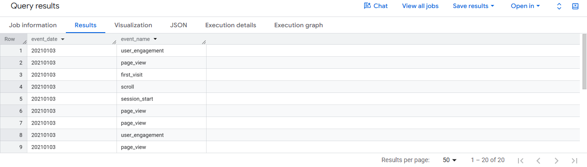
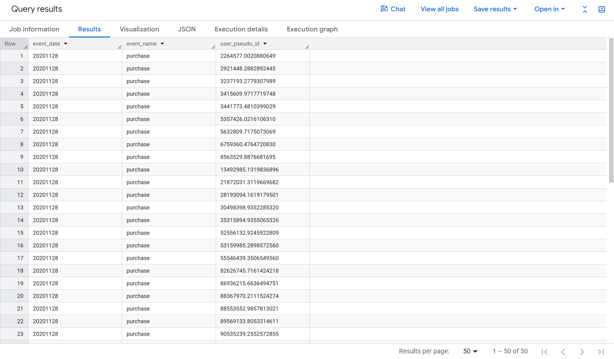
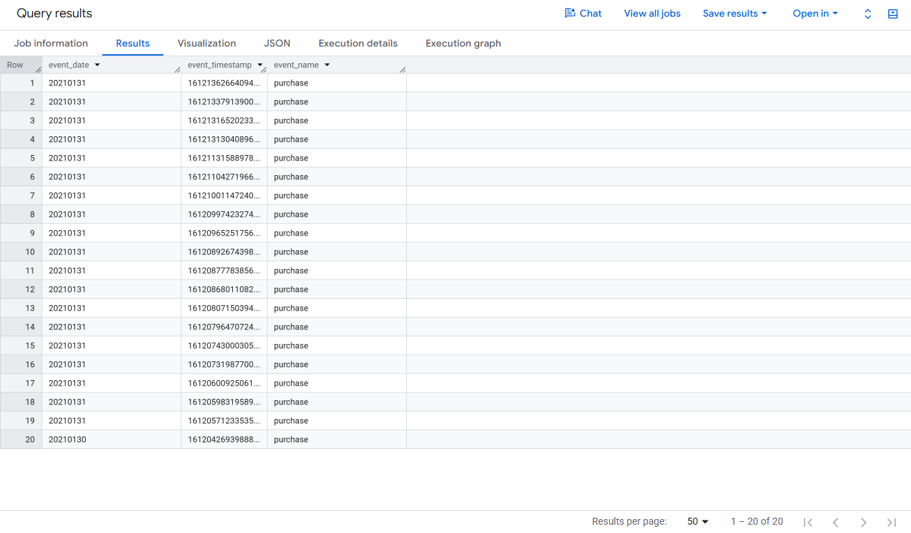
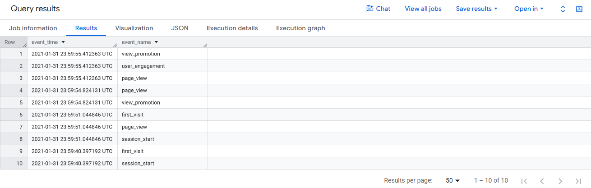
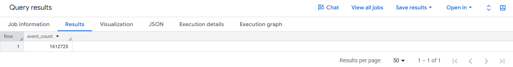
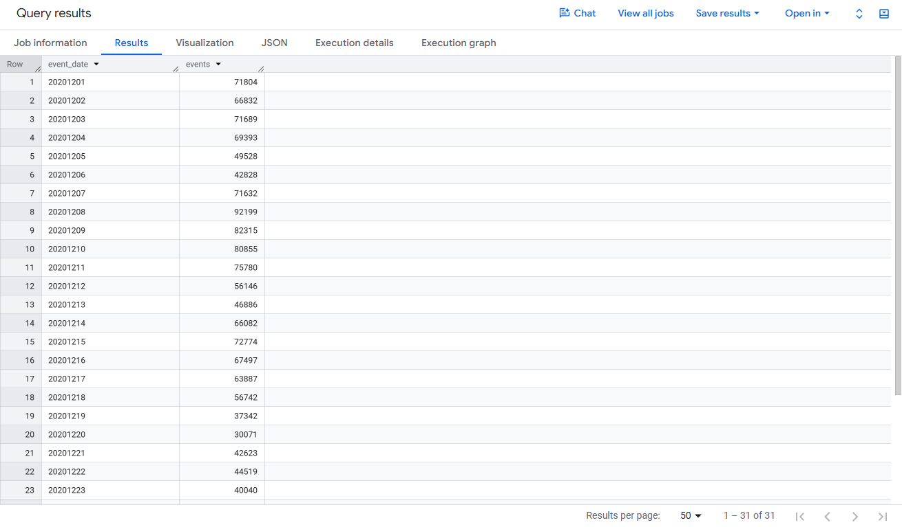
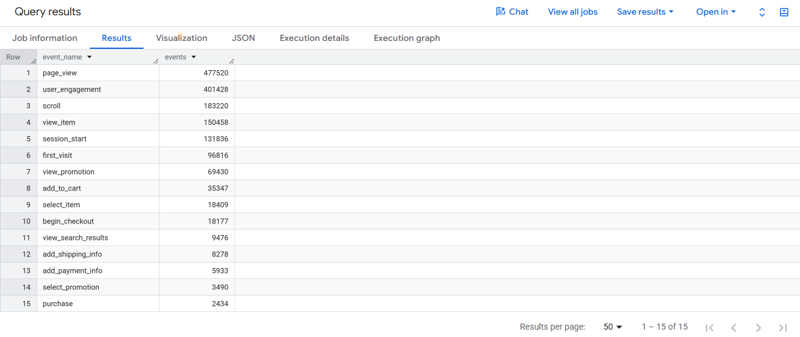
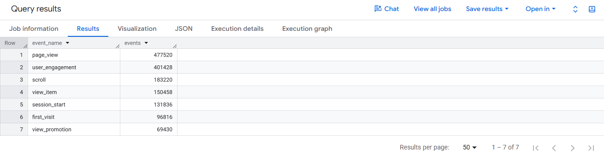
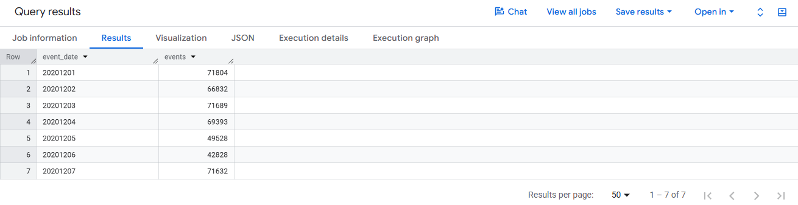

# Overview

This document walks through the Lecture 1 queries in Google BigQuery using the public GA4 sample ecommerce dataset (`bigquery-public-data.ga4_obfuscated_sample_ecommerce`). The dataset holds obfuscated Google Analytics 4 event data from the Google Merchandise Store, stored as one table per day. Each query below is shown in a SQL block, followed by a plain explanation of what it does, a screenshot of its output, and a short note on what the output shows.

**Links:** [GitHub Pages](https://naran115.github.io/bigquery-sql-lecture1/Naranjo,%20Aldo-IC-CP-W04-BigQuery-Lecture1.html) | [GitHub Repo](https://github.com/naran115/bigquery-sql-lecture1)

# Lecture 1 Queries

## SELECT, FROM, and LIMIT

```sql
SELECT event_date, event_name
FROM `bigquery-public-data.ga4_obfuscated_sample_ecommerce.events_*`
LIMIT 20;
```

This query pulls two columns, the date of each event and the name of the event, from every daily table in the dataset. `LIMIT 20` keeps the result to 20 rows so the output stays small. Because there is no sorting, BigQuery returns whichever 20 rows it reaches first, so the specific rows can change from run to run.



The 20 rows returned all came from January 3, 2021, and show everyday site activity such as page views, scrolls, first visits, and session starts.

## WHERE Filters Rows

```sql
SELECT event_date, event_name, user_pseudo_id
FROM `bigquery-public-data.ga4_obfuscated_sample_ecommerce.events_*`
WHERE event_name = 'purchase'
LIMIT 50;
```

The `WHERE` clause keeps only rows where the event is a purchase and drops everything else, like page views and scrolls. It also adds `user_pseudo_id`, which is the anonymous ID GA4 assigns to each browser or device, so we can see which user made each purchase. The result is capped at 50 rows.



Every row now reads "purchase," which confirms the filter worked. Each row carries a different user ID, so these 50 purchases came from different shoppers.

## ORDER BY Sorts Results

### Most Recent Purchases

```sql
SELECT event_date, event_timestamp, event_name
FROM `bigquery-public-data.ga4_obfuscated_sample_ecommerce.events_*`
WHERE event_name = 'purchase'
ORDER BY event_timestamp DESC
LIMIT 20;
```

This query again looks only at purchases, but sorts them by `event_timestamp` from newest to oldest using `DESC`. The 20 rows returned are the 20 most recent purchases in the dataset. The timestamp shows up as a very long number because GA4 records time in microseconds.



The most recent purchases happened on January 31, 2021, the last day in the dataset, with the 20th most recent falling on January 30. The timestamps are hard to read as raw numbers, which sets up the next query.

### Readable Timestamps

```sql
SELECT TIMESTAMP_MICROS(event_timestamp) AS event_time,
       event_name
FROM `bigquery-public-data.ga4_obfuscated_sample_ecommerce.events_*`
ORDER BY event_timestamp DESC
LIMIT 10;
```

`TIMESTAMP_MICROS()` converts that long microsecond number into a normal date and time, and `AS event_time` gives the new column a clear name. This version has no filter, so it shows the 10 most recent events of any type, not just purchases.



The timestamps now read as regular dates and times. The last 10 events in the dataset all happened in the final seconds before midnight on January 31, 2021, and include promotion views, page views, and new visits.

## COUNT, SUM, AVG, MIN, and MAX

These are aggregate functions, which collapse many rows into a single summary value. The lecture examples use `COUNT`, and the others work the same way on numeric columns.

### Total Events in December 2020

```sql
SELECT COUNT(*) AS event_count
FROM `bigquery-public-data.ga4_obfuscated_sample_ecommerce.events_*`
WHERE _TABLE_SUFFIX BETWEEN '20201201' AND '20201231';
```

`COUNT(*)` counts every row, and each row is one event. The `_TABLE_SUFFIX` filter limits the query to the daily tables from December 1 to December 31, 2020, so the result is a single number: total events recorded that month.



The store recorded 1,612,725 events in December 2020.

### Purchases in December 2020

```sql
SELECT COUNT(*) AS purchase_events
FROM `bigquery-public-data.ga4_obfuscated_sample_ecommerce.events_*`
WHERE event_name = 'purchase'
  AND _TABLE_SUFFIX BETWEEN '20201201' AND '20201231';
```

This adds a second condition with `AND`, so only purchase events in December 2020 get counted. Comparing this number to the total above gives a quick sense of how small purchases are relative to all site activity.


There were 2,434 purchases in December 2020. Compared with the 1.6 million total events, that works out to roughly one purchase for every 660 tracked actions on the site.

## GROUP BY Controls the Grain

`GROUP BY` decides what one row in the result represents. Grouping by date gives one row per day, and grouping by event name gives one row per event type.

### Events by Day

```sql
SELECT event_date, COUNT(*) AS events
FROM `bigquery-public-data.ga4_obfuscated_sample_ecommerce.events_*`
WHERE _TABLE_SUFFIX BETWEEN '20201201' AND '20201231'
GROUP BY event_date
ORDER BY event_date;
```

This counts events separately for each day in December 2020 and lists the days in calendar order. The result shows how daily activity rose and fell across the month.



The query returned all 31 days. The busiest day was December 8 with about 92,000 events. Activity dipped on the weekends of December 5 and 6, 12 and 13, and 19 and 20, and dropped off further around December 19 and 20, when traffic fell to roughly 30,000 to 37,000 events a day as holiday shipping deadlines passed.

### Top Event Types

```sql
SELECT event_name, COUNT(*) AS events
FROM `bigquery-public-data.ga4_obfuscated_sample_ecommerce.events_*`
WHERE _TABLE_SUFFIX BETWEEN '20201201' AND '20201231'
GROUP BY event_name
ORDER BY events DESC
LIMIT 15;
```

This counts how many times each type of event happened in December 2020, sorts from most to least common, and keeps the top 15. It shows which user actions make up most of the site's tracked activity.



Page views (477,520) and user engagement (401,428) lead the list. The shopping funnel also shows up clearly: about 150,000 product views led to about 35,000 add to cart events, 18,000 checkouts started, and 2,434 purchases. The purchase count matches the earlier COUNT query exactly, which is a good check that the queries agree.

## HAVING Filters After Grouping

```sql
SELECT event_name, COUNT(*) AS events
FROM `bigquery-public-data.ga4_obfuscated_sample_ecommerce.events_*`
WHERE _TABLE_SUFFIX BETWEEN '20201201' AND '20201231'
GROUP BY event_name
HAVING COUNT(*) >= 50000
ORDER BY events DESC;
```

`WHERE` filters individual rows before they are grouped, while `HAVING` filters the grouped totals afterward. Here the query counts events by type for December 2020, then keeps only the event types with at least 50,000 events.



Seven event types cleared the 50,000 mark, ending with view_promotion at 69,430. The counts match the previous query, but everything from add_to_cart down was removed because it fell below the threshold.

## Wildcard Tables and _TABLE_SUFFIX

```sql
SELECT event_date, COUNT(*) AS events
FROM `bigquery-public-data.ga4_obfuscated_sample_ecommerce.events_*`
WHERE _TABLE_SUFFIX BETWEEN '20201201' AND '20201207'
GROUP BY event_date
ORDER BY event_date;
```

GA4 exports a separate table for each day, named like `events_20201201`. The `*` in `events_*` lets one query read across all of those tables at once, and `_TABLE_SUFFIX` is the date part of each table name. Filtering on it here limits the query to December 1 through 7, 2020, which means BigQuery scans less data and the query runs faster and cheaper.



Only seven rows came back, one for each day from December 1 to 7, and the counts match the first week of the full month query. The weekend of December 5 and 6 again stands out as the slowest stretch of the week.
